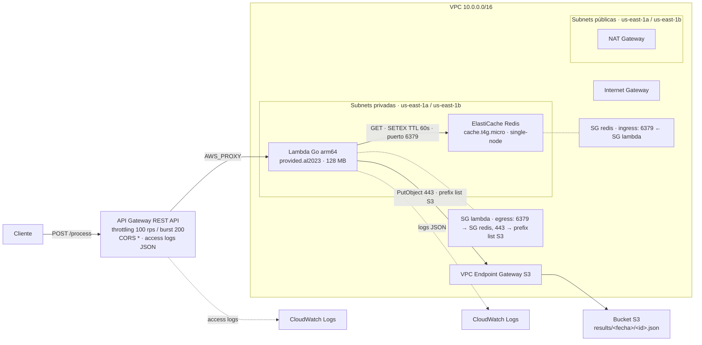

# SRE Interview — API serverless con caché y persistencia en AWS

API serverless que expone `POST /process`: una Lambda escrita en Go, desplegada dentro de una VPC en subnets privadas, consulta Redis como capa de caché (TTL de 60 s) y persiste los resultados en S3 a través de un VPC Endpoint Gateway, sin que el tráfico salga a internet. Toda la infraestructura está definida como código con Terraform.

## Arquitectura



**Segmentación de red** (todo dentro de la VPC):

- La Lambda solo puede salir al puerto 6379 hacia el SG de Redis y al 443 hacia el prefix list de S3 (Gateway Endpoint). Ningún otro egress.
- Redis solo acepta conexiones en 6379 desde el SG de la Lambda.
- El tráfico hacia S3 se resuelve con el VPC Endpoint Gateway asociado a la route table privada: no atraviesa internet ni el NAT.
- La bucket policy de S3 solo autoriza al rol IAM de la Lambda, únicamente sobre el prefijo `results/*` y con la condición `aws:SourceVpce` (acceso exclusivamente a través del endpoint).

## Módulos

| Módulo | Responsabilidad | Recursos principales |
|---|---|---|
| `modules/networking` | Red | VPC, 2 subnets públicas + 2 privadas, IGW, NAT, route tables, VPC Endpoint Gateway S3, SGs de lambda y redis |
| `modules/logic` | Procesamiento | Lambda Go (arm64, VPC), rol IAM, log group de CloudWatch |
| `modules/communication` | API | REST API regional, `POST /process` (AWS_PROXY), CORS, stage con throttling y access logs |
| `modules/cache` | Caché | ElastiCache Redis single-node, subnet group, parameter group |
| `modules/storage` | Persistencia | Bucket S3 (Block Public Access, versionado, SSE), bucket policy |
| `lambda/process` | Código | Handler Go y build automático del binario `bootstrap` arm64 |

## Flujo de la petición

1. `POST /process` llega a API Gateway: throttling a nivel de stage (100 rps / burst 200), CORS para cualquier origen y access logs en CloudWatch.
2. API Gateway invoca la Lambda vía integración proxy (`AWS_PROXY`); el permiso de invocación está acotado a `stage/POST/process`.
3. La Lambda genera la cache key: SHA-256 del body (o del query param `input` si no hay body).
4. Consulta Redis:
   - **HIT** → responde `200` con header `X-Cache: HIT` (típicamente ~2 ms).
   - **MISS** → procesa el request (inversión del texto), guarda el resultado en S3 bajo `results/<fecha>/<id>.json`, escribe en Redis con TTL de 60 s y responde `200` con `X-Cache: MISS`.
5. Cualquier error se registra en CloudWatch (formato JSON) y retorna `500` con un mensaje descriptivo y header `X-Cache: MISS` (el header está presente en todas las respuestas).

## Requisitos

Herramientas obligatorias:

| Herramienta | Versión | Uso |
|---|---|---|
| Terraform | ~> 1.16.5 | Aprovisionar la infraestructura |
| Go | 1.26+ | Compilar la Lambda (el build es automático durante el `apply`) |
| AWS CLI | v2 | Comandos de verificación y evidencias |

Cuenta y permisos AWS:

- Credenciales AWS configuradas por cualquiera de las vías estándar: variable `AWS_PROFILE`, variables de entorno o perfil `default`. Alternativamente, fija tu perfil con la variable `aws_profile` en `terraform.tfvars` (por defecto es `null` y se usa la cadena de credenciales estándar).
- Permisos sobre: EC2 (VPC, subnets, security groups, endpoints, NAT), IAM (roles y políticas), Lambda, API Gateway, ElastiCache, S3, CloudWatch Logs y STS.
- Región por defecto: `us-east-1` (variable `aws_region`). Si la cambias, ajusta las AZs de `public_subnet_cidrs` / `private_subnet_cidrs` en `terraform.tfvars`.

### Entorno reproducible con Nix (opcional)

El repositorio incluye un `flake.nix` que provee el toolchain completo (Terraform, AWS CLI, Go, jq) con versiones pineadas del `flake.lock`, ofreciendo máxima reproducibilidad del entorno. **No es un requisito**: cualquier instalación manual de las herramientas de la tabla anterior funciona igual.

```bash
nix develop
```

## Despliegue desde cero

```bash
# (Opcional) ajusta region, perfil AWS, entorno o diseño de red
cp terraform.tfvars.example terraform.tfvars

terraform init
terraform plan
terraform apply
```

Notas del despliegue:

- El build de la Lambda es automático: un `null_resource` compila el binario (`GOOS=linux GOARCH=arm64 CGO_ENABLED=0 go build -o bootstrap`) y `archive_file` lo empaqueta. Cualquier cambio en `main.go`, `go.mod` o `go.sum` dispara rebuild y redeploy de la función.
- Tests unitarios de la Lambda (fakes de Redis/S3, sin conexiones reales): `cd lambda/process && go test ./...`
- El primer `apply` tarda ~10 minutos; ElastiCache y el NAT Gateway son los recursos más lentos.
- El state es local (`terraform.tfstate`). Para un entorno real conviene un backend remoto (S3) con locking (DynamoDB).

Outputs principales:

```bash
terraform output process_endpoint        # URL del API
terraform output s3_results_bucket_name  # bucket de resultados
terraform output redis_endpoint_address  # endpoint de Redis
```

## Verificación end-to-end

```bash
ENDPOINT=$(terraform output -raw process_endpoint)

# 1) Primera llamada: MISS (procesa, guarda en S3 y escribe Redis con TTL 60s)
curl -s -X POST "$ENDPOINT" -H "Content-Type: application/json" \
  -d '{"input":"hola mundo"}' -D -

# 2) Misma petición: HIT (servida desde Redis, ~2ms)
curl -s -X POST "$ENDPOINT" -H "Content-Type: application/json" \
  -d '{"input":"hola mundo"}' -D -

# 3) Tras 60s la key expira y vuelve a ser MISS
sleep 65 && curl -s -X POST "$ENDPOINT" -H "Content-Type: application/json" \
  -d '{"input":"hola mundo"}' -D -

# 4) Preflight CORS
curl -s -X OPTIONS "$ENDPOINT" -H "Origin: https://ejemplo.com" \
  -H "Access-Control-Request-Method: POST" -D - -o /dev/null

# 5) Objeto persistido en S3
aws s3 ls "s3://$(terraform output -raw s3_results_bucket_name)/results/" --recursive

# 6) Logs de la Lambda en CloudWatch
aws logs tail "/aws/lambda/$(terraform output -raw lambda_function_name)" --since 15m
```

Las salidas reales de estas verificaciones contra el stack desplegado están en [`evidence/`](evidence/).

## Decisiones de diseño

### REST API vs HTTP API

Se usa REST API (v1) en lugar de HTTP API (v2). HTTP API es más barata y simple, pero REST API ofrece el control que este stack necesita: throttling a nivel de stage vía `aws_api_gateway_method_settings` (en el provider v6 los argumentos de throttling del stage fueron removidos y esta es la vía correcta), access logs con formato JSON custom por stage y métricas por método. En HTTP API el throttling es más limitado y los access logs menos flexibles.

### Tamaño de nodo de Redis

`cache.t4g.micro`: es el nodo más económico disponible (Graviton, ~$12/mes), por debajo del `cache.t3.micro`. Se despliega como cluster single-node en lugar de un replication group: es una capa de caché con TTL corto donde no se justifica pagar failover ni réplicas. Como defensa adicional, el parameter group fija `maxmemory-policy = volatile-ttl`: bajo presión de memoria Redis solo expulsa keys con TTL, alineado con la política de que ninguna key persiste indefinidamente (la app siempre escribe con `SETEX` y TTL de 60 s).

### Go + ARM para la Lambda

Go produce un binario estático único (con `CGO_ENABLED=0`): paquete de ~10 MB, cold starts rápidos y bajo consumo de memoria. La compilación cruzada es nativa del lenguaje (`GOOS=linux GOARCH=arm64`), lo que hace trivial elegir arm64/Graviton, ~20% más barato por GB-segundo que x86. El runtime es `provided.al2023` con handler `bootstrap`, ya que el runtime `go1.x` está deprecado y removido en AWS.

## Estructura del proyecto

```
├── main.tf / outputs.tf / variables.tf / providers.tf / versions.tf / backend.tf
├── flake.nix                        # entorno Nix opcional
├── lambda/process/                  # handler Go (main.go, go.mod)
├── modules/
│   ├── networking/                  # VPC, subnets, IGW, NAT, endpoint S3, SGs
│   ├── logic/                       # Lambda, IAM, CloudWatch
│   ├── communication/               # API Gateway REST
│   ├── cache/                       # ElastiCache Redis
│   └── storage/                     # S3 + bucket policy
└── evidence/                        # evidencias del flujo end-to-end
```

## Evidencias

La carpeta [`evidence/`](evidence/) contiene salidas reales del stack desplegado; cada archivo incluye en su cabecera el comando exacto que la generó y la fecha:

| Archivo | Evidencia |
|---|---|
| `01-request-miss.txt` | Primera llamada: `200` con `X-Cache: MISS` |
| `02-request-hit.txt` | Misma petición: `200` con `X-Cache: HIT` |
| `03-s3-object.txt` | Objetos persistidos en S3 bajo `results/<fecha>/<id>.json` (`aws s3 ls`) |
| `04-ttl-expiry.txt` | Tras 65 s: `X-Cache: MISS` de nuevo (TTL de 60 s efectivo) |
| `05-cors-preflight.txt` | Preflight `OPTIONS`: `204` + `Access-Control-Allow-Origin: *` |

## Limpieza y costos

```bash
# El bucket debe vaciarse antes del destroy (no tiene force_destroy)
aws s3 rm "s3://$(terraform output -raw s3_results_bucket_name)" --recursive
terraform destroy
```

Costo aproximado con el stack desplegado: **~$45/mes** — NAT Gateway ~$33 + ElastiCache ~$12; Lambda, API Gateway y S3 son despreciables a este tráfico. Si no se necesita egress a internet desde las subnets privadas, eliminar el NAT reduce el costo a ~$12/mes.
